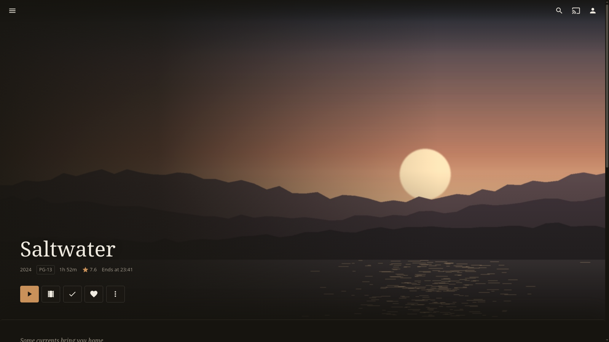
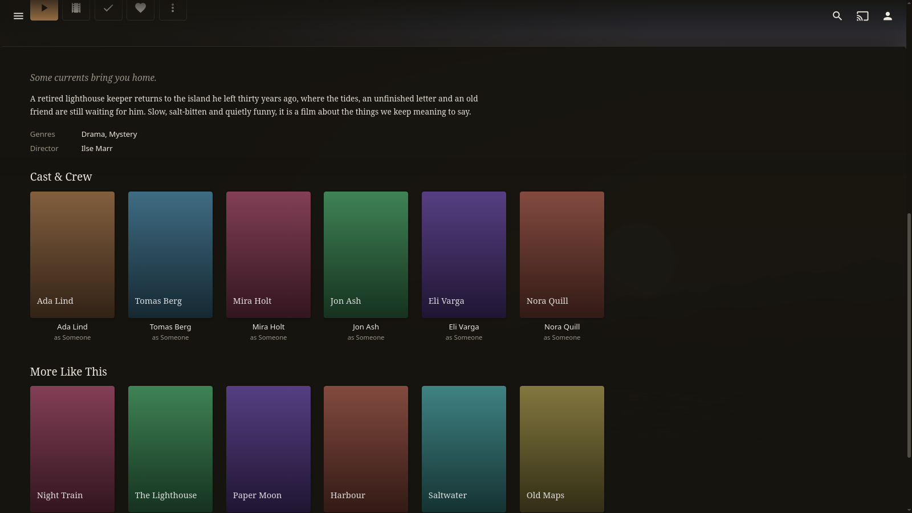
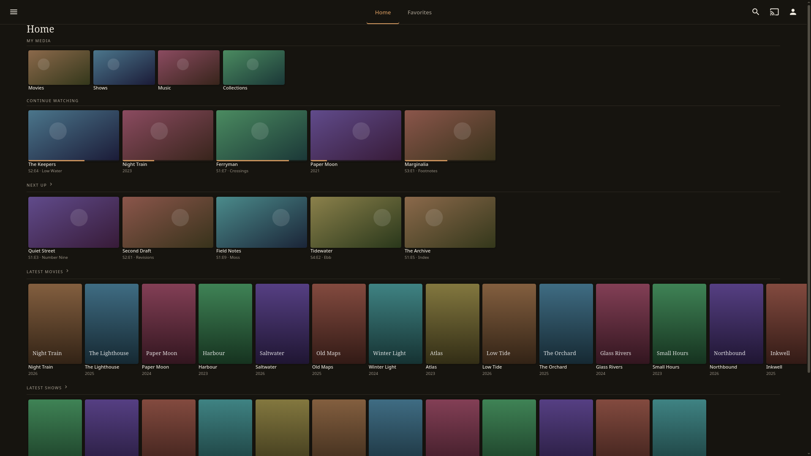
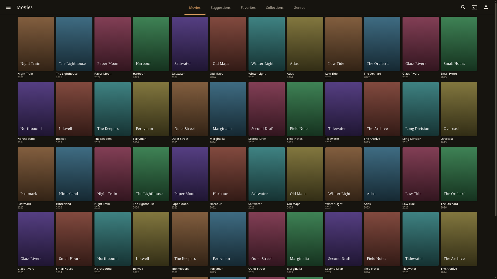
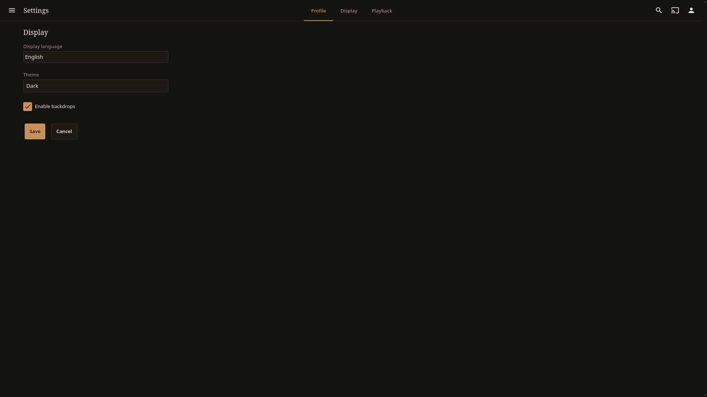

# Sepia Paper for Jellyfin

A calm, warm dark theme for Jellyfin: dark paper tones, thin hairlines instead of
boxes and glow, one sepia accent, and serif titles.

When you open a **movie or a series**, the picture fills the whole screen. The title,
facts and buttons sit at the bottom-left over it. Scroll down and the overview, cast
and episodes slide up over the picture on a sheet of paper.




## Install

In Jellyfin, open **Dashboard → Branding** (in older versions: **Dashboard → General**), paste this line into **Custom CSS code** and save:

```css
@import url("https://nagasab221.github.io/jellyfin-sepia-paper/sepia-paper.css");
```

Then turn on **Settings → Display → Backdrops**. Jellyfin only loads the big picture on desktop
when that's on, and the theme turns it into the fullscreen picture on movie and series pages.
Other pages stay calm and don't show backdrops.

Reload the page (Ctrl+Shift+R in a browser). That's it: it applies to every user and to
every app that uses Jellyfin's web interface (browsers, Jellyfin Desktop, Jellyfin Media
Player, the Android app). Native apps with their own interface (Swiftfin, Findroid, most
TV apps) don't load custom CSS.

Only want it for yourself? Paste the same line in **Settings → Display → Custom CSS** instead.

## Settings

Put any of these **under** the `@import` line to change them:

```css
:root {
  --sp-accent-rgb: 201 145 90;   /* the accent colour, as "R G B" */
  --sp-backdrop-tone: .15;       /* sepia tint on the fullscreen picture: 0 = none, 1 = full */
  --sp-backdrop-dim: 1;          /* how dark the shading behind the title is: 0–1 */
  --sp-page-backdrops: none;     /* "block" to show Jellyfin's backdrops on other pages too */
  --sp-home-title: "Home";       /* the home page masthead; "" hides it, or write your own */
  --sp-radius: 4px;              /* corner rounding */
}
```

## What changes

| | |
|---|---|
| **Everywhere** | The page in warm dark paper (`#16140f`), surfaces a shade lighter, 1px hairlines, the sepia accent only on what matters: the active tab, Play, progress, selections and focus |
| **Type** | Noto Serif for page, section and item titles, and for overviews; Noto Sans for everything else |
| **Movie & series pages** | A fullscreen picture with a soft shade from the left and bottom, a large serif title and quiet square buttons with a sepia Play. Below that, a paper sheet holds the overview, cast and episodes |
| **Home page** | Compact, like a reading-app library: a serif masthead, small letterspaced section labels over hairlines, dense rows of small covers with titles set flush left, and a thin sepia progress line. "My Media" shown as buttons becomes a row of small chips |
| **Library grids** | Denser: 12 posters per row on a 1080p screen instead of 9, titles flush left |
| **Cards** | Flat covers with small corners, no shadow; a sepia hairline on hover and small, quiet hover buttons (only Play is sepia). The row arrows ‹ › are small chevrons on the section line |
| **Top bar** | The library links (server name, Favorites, Movies, Series) are gone because the home page already has them. Back and the logo (home) stay. On the home page the bar disappears and only a small pill of icons floats at the top right |
| **Header & menu** | Flat paper with a hairline. Tabs are muted, and the active one gets a sepia underline |
| **Video player** | Like a reading app's bottom bar: a slim strip of paper with a hairline edge, a thin sepia progress line with a small cream knob, muted times, quiet buttons with a sepia play/pause, and the title in the serif over a soft fade |
| **Forms & dialogs** | Paper fields with a hairline that turns sepia when focused, a sepia primary button, and surfaces that use hairlines instead of heavy shadows |





The fullscreen picture shows on the desktop layout when Backdrops are on and the item has a
backdrop image. Without one, the page keeps the poster layout, with a short top band and a serif title.
Title logos (the artwork Jellyfin downloads for a show's name) are hidden on desktop; the serif
title replaces them, because store logos are often low resolution and look blurry when enlarged. Phones keep Jellyfin's own layout,
in the same colours.

Made for **Jellyfin 10.10 – 12.x** (the screenshots use Jellyfin 12.4's stylesheets).
It needs a browser with CSS `:has()` support (Chrome/Edge 105+, Firefox 121+, Safari 15.4+,
recent Jellyfin Desktop).

## Development

`sepia-paper.css` is the whole theme.

`dev/jfdebug.py` drives a real Jellyfin client over the Chrome DevTools protocol: run JavaScript,
take screenshots, navigate, and load your local `sepia-paper.css` in place of the published one,
all without publishing anything. Start Jellyfin Desktop (Flatpak) with
`flatpak run --env=QTWEBENGINE_REMOTE_DEBUGGING=127.0.0.1:9222 org.jellyfin.JellyfinDesktop`.
It needs `python-websocket-client`.

`dev/preview.py` renders the theme offscreen on mock pages built from Jellyfin's own templates
and stylesheets. It needs `python3-pyside6` and a local `jellyfin-web` install:

```sh
python3 dev/make_backdrop.py /tmp/backdrop.jpg
QT_QPA_PLATFORM=offscreen python3 dev/preview.py /tmp/preview /tmp/backdrop.jpg
```

## Credits

- The fullscreen detail picture was inspired by [infinitv](https://github.com/buesche87/infinitv).
- The colours come from the dark "Paper" style of [PaperView](https://github.com/nagasab221/PaperView-Desktop), a PDF and ebook reader. The same palette is available for KDE Plasma and Firefox in [sepia-paper-theme](https://github.com/nagasab221/sepia-paper-theme).

MIT licensed.
